

  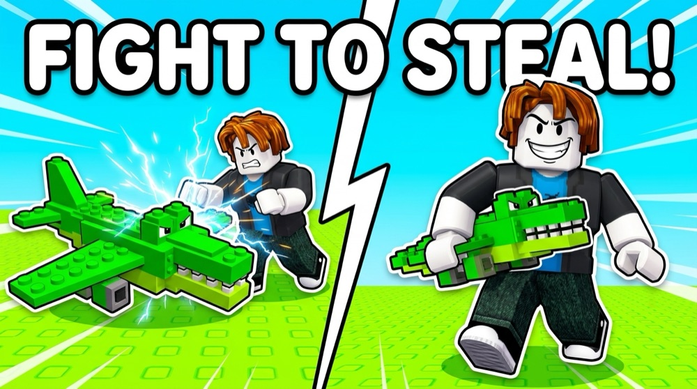

<h1 align="center">⚔️ Fight to Steal</h1>

  <b>Catch them. Train them. Fight for them. The winner steals.</b> 
  A Roblox creature-collecting game for kids, designed and built by one developer working with AI.

  
  
  
  

---

## 🎮 The game

A wild island full of blocky fighters, from lions and sharks to ninjas and very confused cows. You catch them, carry them home and put them in your pen, where **every fighter earns you cash every second**. You train them, hatch more, and then put one on the line: **fight another player, and the winner steals the fighter.**

That's the hook. Every creature is both a fighter and an income stream, so even one you never fight with is worth stealing, and worth defending.

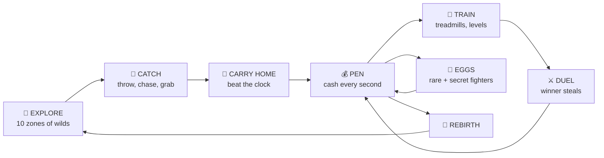

<table>
  <tr>
    <td width="50%">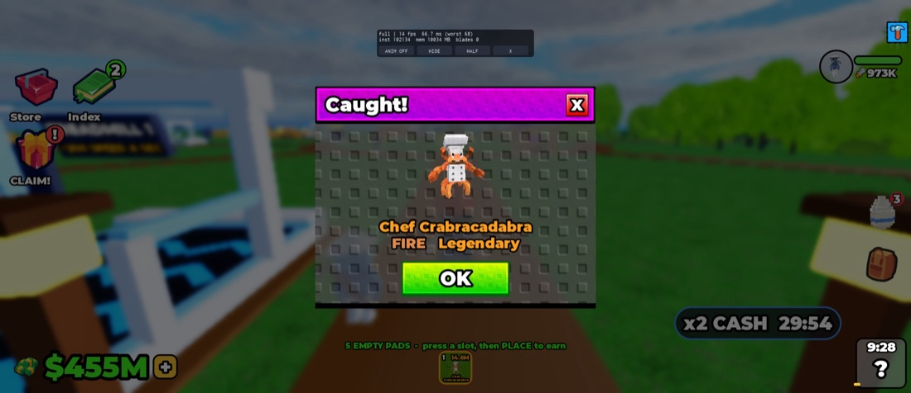 <b>Caught!</b> A Legendary FIRE fighter joins the team.</td>
    <td width="50%">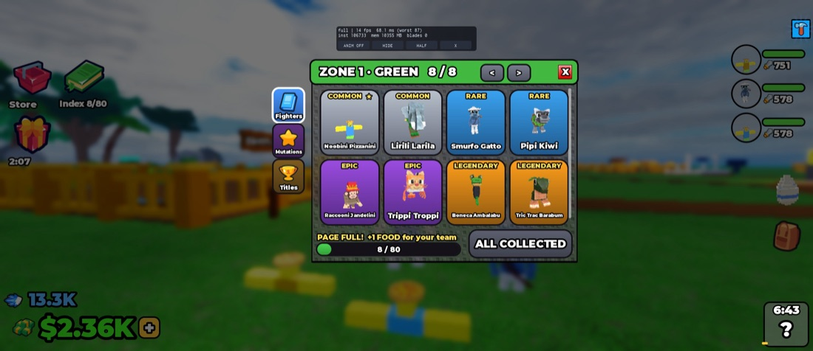 <b>Collect.</b> Fill each zone's page, from Common to Legendary.</td>
  </tr>
  <tr>
    <td>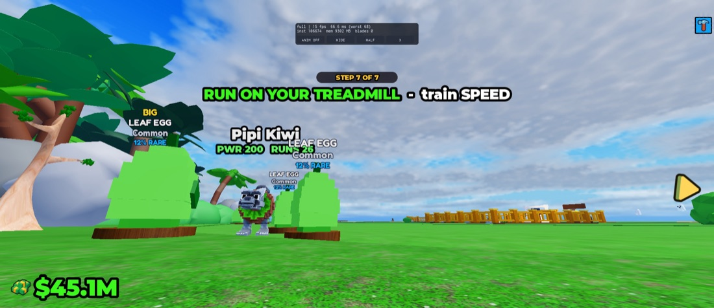 <b>Train.</b> Treadmills build SPEED, and eggs wait in every zone.</td>
    <td>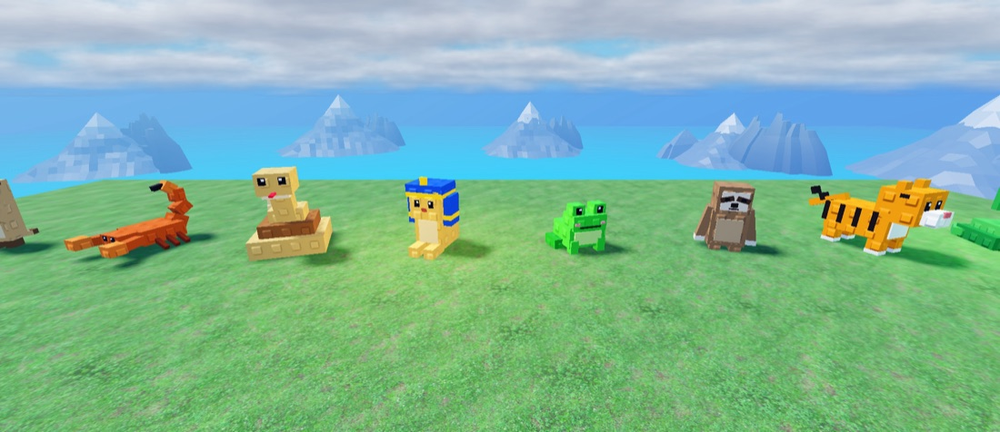 <b>The cast.</b> Fighters roam the island in the wild.</td>
  </tr>
</table>

## ✨ What's inside

| | |
|---|---|
| 🌍 **10 zones** | One island, ten biomes, from forest and beach through desert, jungle, snow and sky to ocean and space, each with its own roster and landmarks. |
| 🐾 **170+ fighters** | Common, Rare, Epic and Legendary, plus Secret and OG variants and mutations. |
| 🔥 **5 families** | WATER → FIRE → LEAF → BLADE → ZAP → WATER. A type wheel that "water puts out FIRE" explains to an eight-year-old. |
| ⚔️ **Fights** | Pick your fighter and time your special. Every fight plays out the same on every server, because a fighter is at stake. |
| 🏃 **The catch** | Throw a ball, chase down wilds that run, and carry your catch home against a clock. |
| 💰 **Idle income** | Your pen pays every second, even while you're away. |
| 🏟️ **Arena + gauntlet** | Climb a ladder of challengers, fight other players, rescue raids. |
| 🎉 **Live world** | Restock rushes, timed events, weather, day and night, and a music director. |
| 📖 **Index** | Every fighter you've met, page by page, with rewards for full pages. |
| 🛒 **Shop** | Moment offers, a starter pack, boosts, all aimed at the moments a kid actually wants them. |

<table>
  <tr>
    <td width="33%">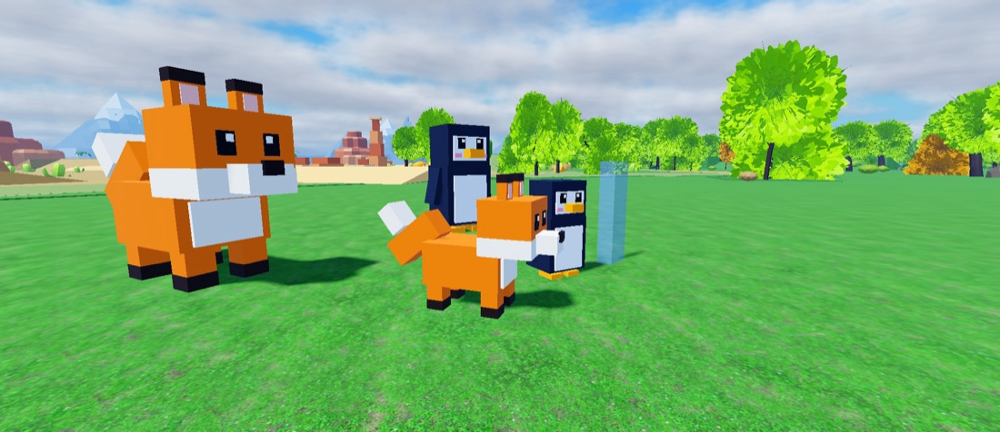</td>
    <td width="33%">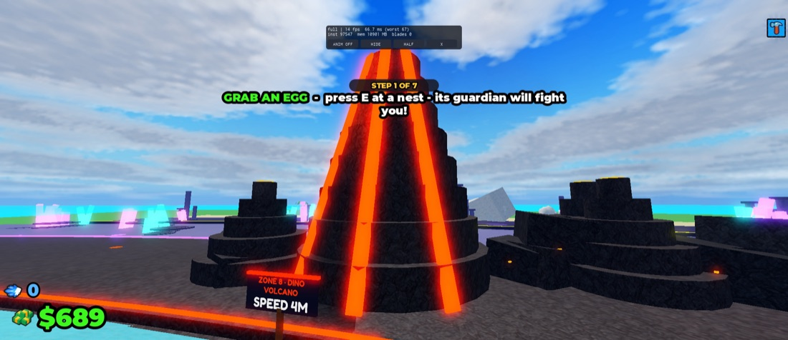</td>
    <td width="33%">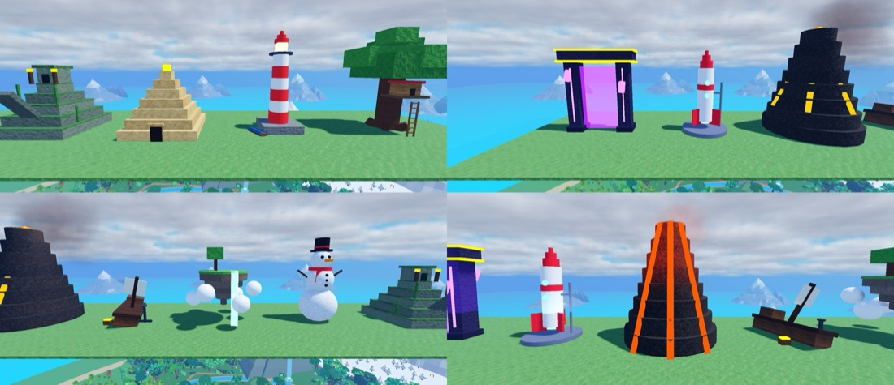</td>
  </tr>
</table>

### Store art

<table>
  <tr>
    <td width="33%">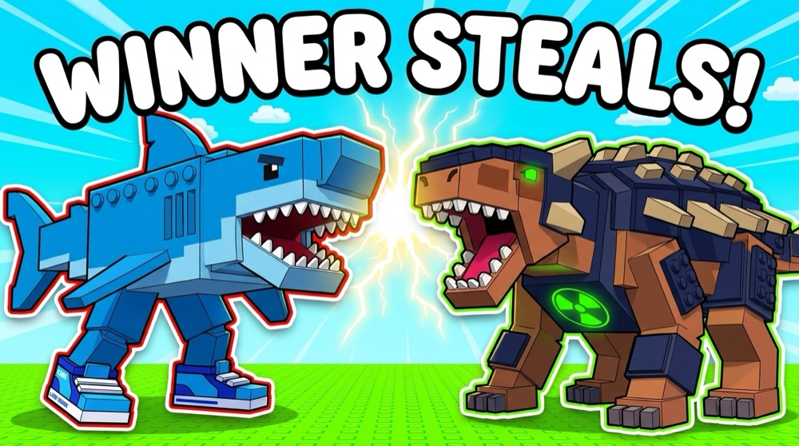</td>
    <td width="33%">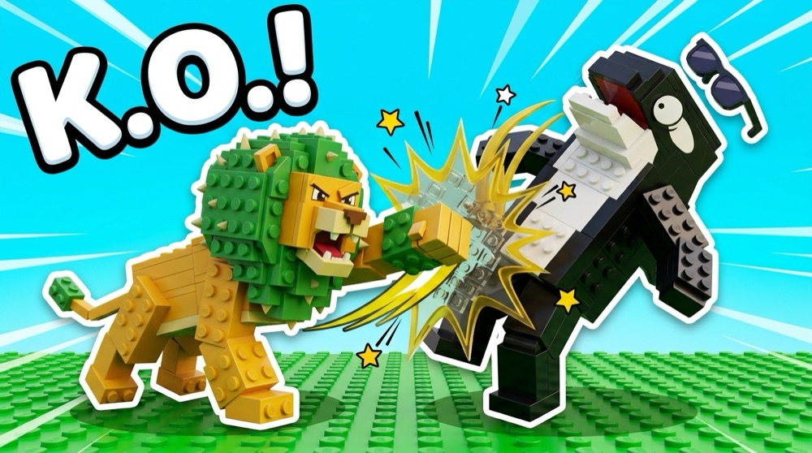</td>
    <td width="33%">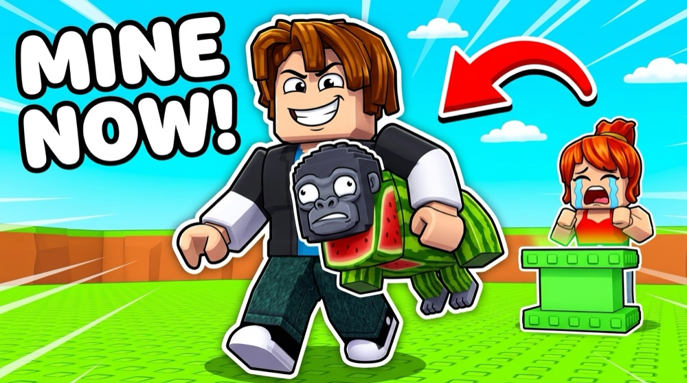</td>
  </tr>
  <tr>
    <td>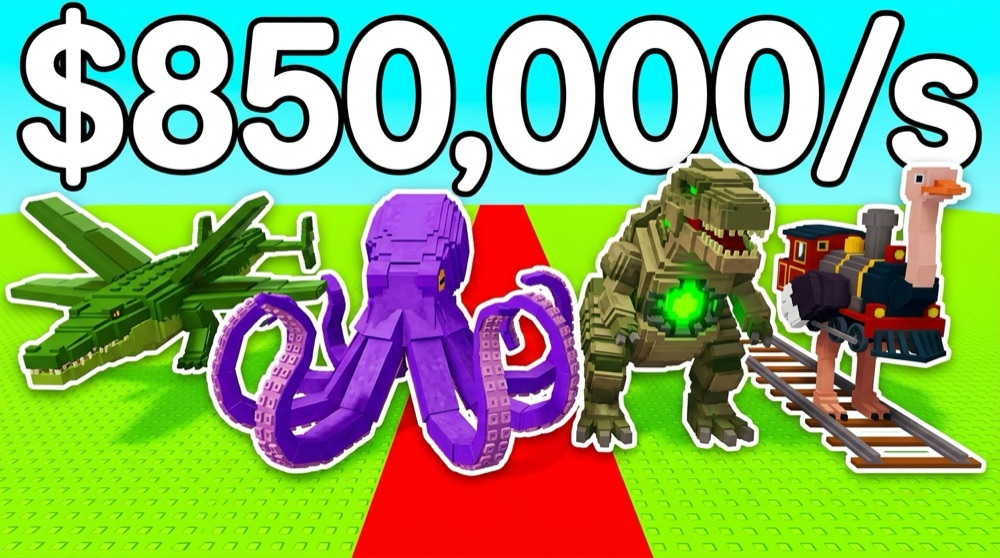</td>
    <td>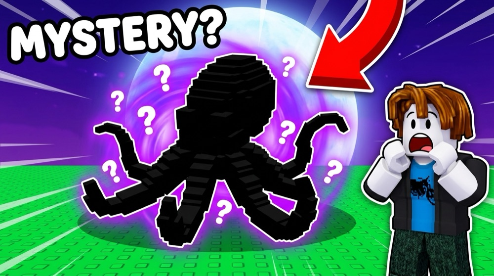</td>
    <td>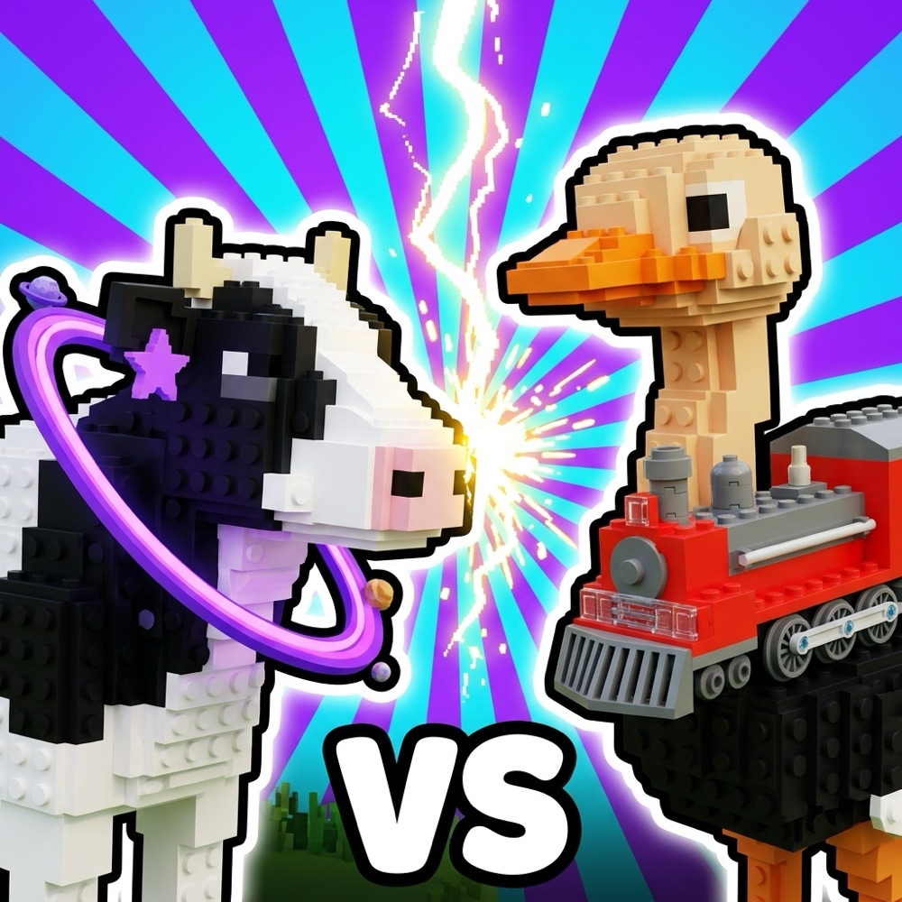</td>
  </tr>
</table>

## 🤖 How it was built

I designed the game. **Claude Code** sessions built it by driving Roblox Studio directly over MCP: reading and editing live scripts, running play sessions and taking screenshots.

**A design ledger instead of memory.** Every design call, from "fighters are fought for, never bought" to "water beats fire", was written down as a numbered ruling with its reason, **853 of them** by the end. Each new session read the ledger before touching anything, so two months of decisions never got lost or quietly undone.

**Systems, not one big script.** About 40 server services (duels, arena, matchmaking, pens, income, eggs, chases, gauntlet, rescues, restocks, events, rebirth, saves) plus about 60 focused client scripts for animation, feel, camera and phone performance.

**A fight engine you can trust with stakes.** The battle core has no randomness, no clock and no side effects. The same fighters and the same button presses always give the same fight. That's what makes stealing fair.

**Measured, not guessed:**

- An in-game test harness of **9,000+ assertions** ran on every change.
- The economy and growth curves were **simulated in Python** before a number changed.
- **Analytics funnels** tracked every first-time step, and a daily dashboard showed where kids left.
- Phone performance was profiled live, with a quality governor for slow devices.

## 🧭 What happened next

Fight to Steal ran from August to early October 2026, and by then it had grown big: 434 scripts, 168K lines, 160 feature switches. For the young kids it was made for, it had become too much to take in. So I made a hard call: keep everything I learned (the tools, the test harness, the analytics, the way of working) and **start fresh** with one simple loop. That became [**+1 Spin to Fly**](https://github.com/Idosiloni/Spin-To-Fly), built and launched in five days on the same place.

## 🧰 Tech

**Roblox Studio + Luau** (server-authoritative, strict-typed core, backed-up DataStore saves) · **Roblox Studio MCP** · **Python** simulators · **Roblox AnalyticsService + Open Cloud** · **Claude Code**

---

  The source code is private. This repo is a showcase. 
  Made by <b>Ido Siloni</b> · 2026 · also by me: <a href="https://github.com/Idosiloni/Spin-To-Fly">+1 Spin to Fly</a> · <a href="https://github.com/Idosiloni/Lucky-Ticket-Tycoon">Lucky Ticket Tycoon</a>

